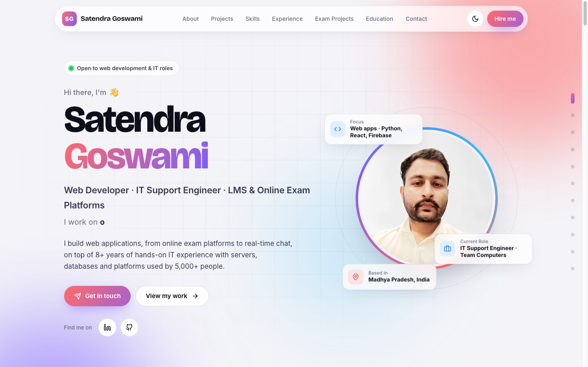
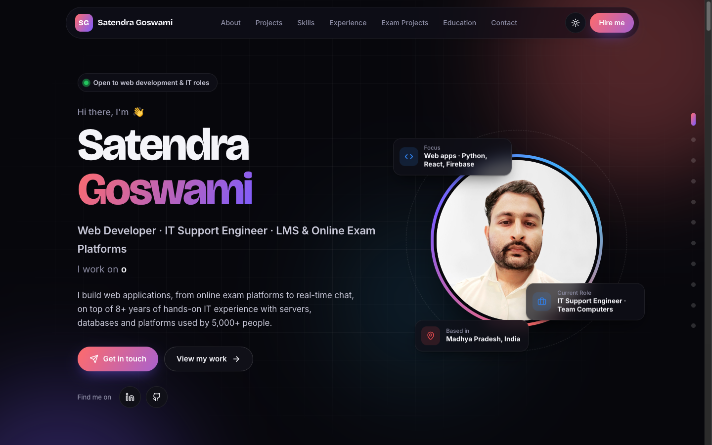
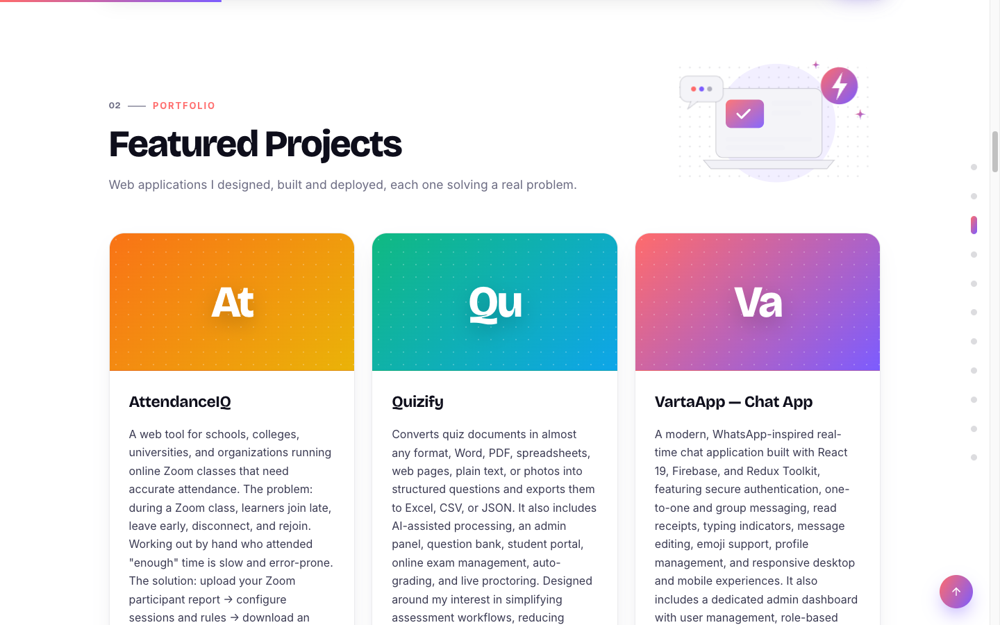
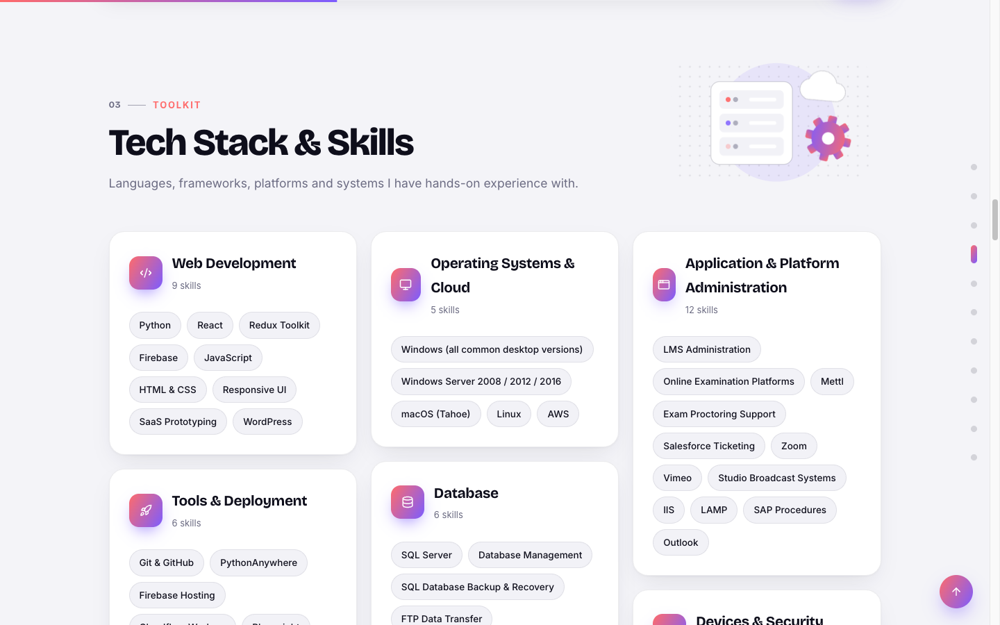
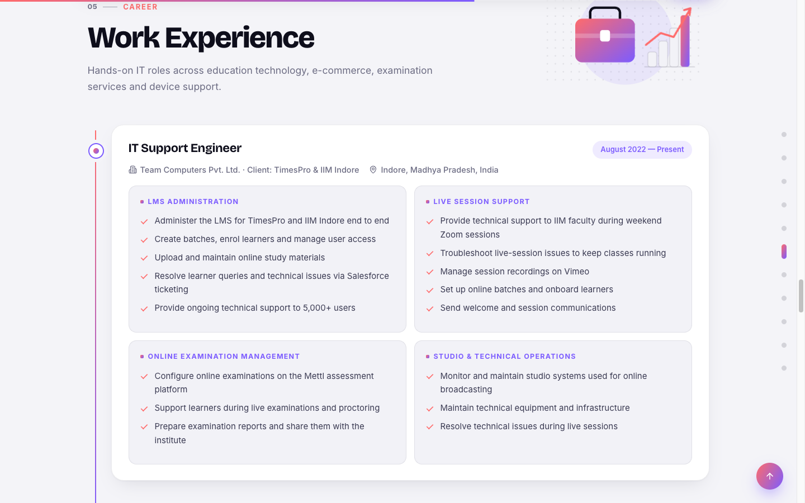
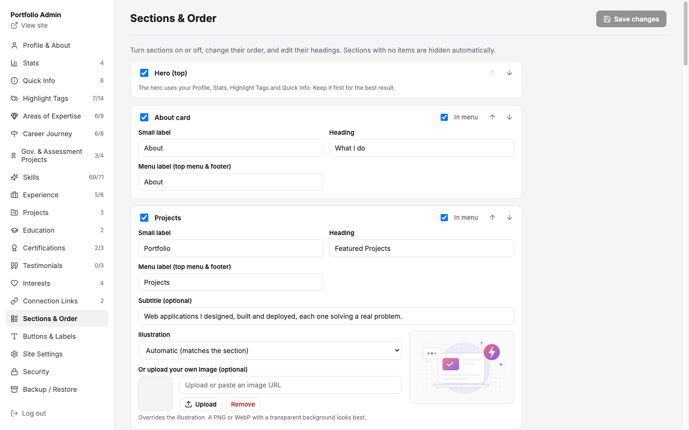
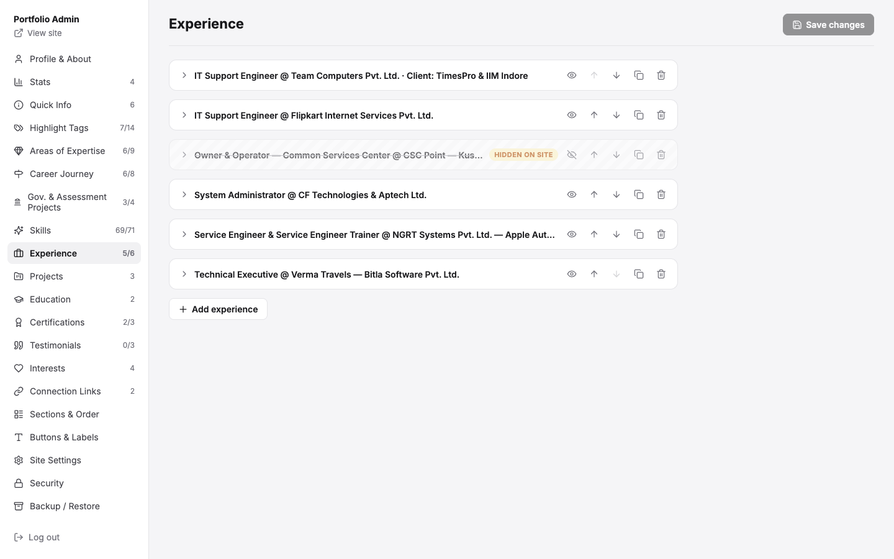
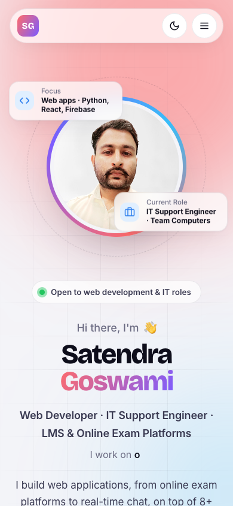

# Portfolio Website with Admin Panel

A modern personal portfolio where **every word, section, image, colour and setting is editable from a
built-in admin panel**, with no code changes or redeploys needed. It runs **free on Cloudflare Workers + KV**, or on
your own computer with Node.js. No framework, no build step, no database server.

**Live example:** <https://satendragoswami.satendragoshwami.workers.dev>



<table>
  <tr>
    <td></td>
    <td></td>
  </tr>
  <tr>
    <td></td>
    <td></td>
  </tr>
  <tr>
    <td></td>
    <td></td>
  </tr>
</table>

---

## Features

### Website
- Hero with typed highlights, animated stat counters, floating info cards around the photo and a scrolling skills strip
- Sections: About · Projects · Tech stack & skills · Areas of expertise · Testimonials · Experience timeline (older roles fold) · Career journey · Highlighted projects · Education & certifications · Hobbies · Contact
- Hand-made SVG illustrations per section that follow the site colours and dark mode
- Light / dark theme, sticky nav with active-section highlight, side section navigator, scroll progress, back-to-top
- Fully responsive with a dedicated mobile layout 
- Server-side SEO: title, description, keywords, Open Graph / LinkedIn previews and JSON-LD `Person` profile
- Respects `prefers-reduced-motion`

### Admin panel (`/admin/`)
- Edit **everything**: profile, about text, stats, skills, jobs, projects, testimonials, education, links…
- Add, reorder, duplicate, delete, and **hide items with an eye toggle** (kept, just not shown)
- Show/hide and reorder whole sections, rename headings and menu labels, pick an illustration per section
- **Buttons & Labels** page: every small fixed word on the site is editable
- Upload photos and PDFs (resume), change colours, theme, SEO and feature toggles
- Backup/restore all content as JSON; every save keeps the previous version
- Email + password login (hashed), 5-attempt lockout, HttpOnly session cookies, image/PDF-only uploads

---

## Quick start (on your computer)

Requirements: [Node.js](https://nodejs.org) 18+.

```bash
git clone https://github.com/satendragoswamii/portfolio-website-with-admin-panel.git
cd portfolio-website-with-admin-panel
npm install
npm run set-admin   # choose your admin email + password (stored hashed in data/auth.json)
npm start           # http://localhost:3000  ·  admin: http://localhost:3000/admin/
```

Then open the admin, replace the sample content with your own, upload your photo and click **Save changes**.

---

## Deploy for free on Cloudflare

Step-by-step guide (no prior Cloudflare experience needed): **[DEPLOY.md](DEPLOY.md)**

In short:
1. Create a KV namespace and paste its ID into `wrangler.jsonc`.
2. Workers & Pages → **Import a repository** → deploy command `npx wrangler deploy`.
3. Add the `ADMIN_EMAIL` and `ADMIN_PASSWORD` secrets → sign in at `/admin/`.

Until you save in the admin, the live site shows the content from `data/content.json`, so there's no manual data
upload. Every push to GitHub redeploys the code; content saved in the admin is never overwritten.

---

## How it works

| Path | Purpose |
| --- | --- |
| `public/` | The website (`index.html`, `css/`, `js/main.js`, `js/graphics.js`) and the admin panel (`admin/`) |
| `public/admin/schema.js` | Defines every editable field. Add a field here and it appears in the admin |
| `src/worker.js` | Cloudflare Worker: JSON API, login, uploads; content stored in Workers KV |
| `src/seo.mjs` | Builds SEO / share-preview tags on the server (used by both backends) |
| `server.js` | Local Node/Express backend with the same API (`data/content.json`, `uploads/`) |
| `data/content.json` | Sample content: the starting point for your site |
| `wrangler.jsonc` | Cloudflare config (Worker name, KV namespace ID) |
| `scripts/` | `set-admin` (local login), `seed-kv` (copy content to KV), `snapshot-site` / `restore-snapshot` (back up / restore a live site) |

The front end is plain HTML/CSS/JavaScript that renders from one JSON document (`/api/content`).
Both backends expose the same small API, so the site and admin behave identically locally and on Cloudflare.

### Writing tips for text fields
- Blank line = new paragraph; lines starting with `- ` become bullets; `### ` starts a sub-heading in experience descriptions.
- Icons are [Lucide](https://lucide.dev/icons/) names (`server`, `graduation-cap`, `github`, `linkedin`, `whatsapp`…).

---

## Backups

```bash
# Download everything a live site has saved (content, uploads, history) into site-snapshots/<name>/
node scripts/snapshot-site.mjs my-site <kv-namespace-id> https://my-portfolio.<subdomain>.workers.dev
# Put it back (overwrites that site's content)
node scripts/restore-snapshot.mjs my-site <kv-namespace-id>
```

> Snapshots contain your personal content. Keep them in a **private** repository.

---

## Attribution

Every site built with this project shows a small **"Built by Satendra Goswami"** credit with GitHub, LinkedIn and
WhatsApp links in the footer. It is part of the code, not the admin content, so it stays whatever you edit in the
admin panel. If you use this project, **please keep the credit**. Thank you! See [NOTICE](NOTICE).

## Credits

Built by **Satendra Goswami** ([LinkedIn](https://www.linkedin.com/in/satendragoswami/) · [GitHub](https://github.com/satendragoswamii)).
Icons by [Lucide](https://lucide.dev) · Fonts: Bricolage Grotesque & Inter (Google Fonts).

Licensed under the [MIT License](LICENSE). You're welcome to use it for your own portfolio.
